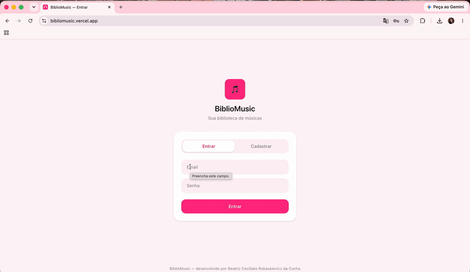

# 🎧 BiblioMusic

🔗 **[Ver o projeto no ar](https://bibliomusic.vercel.app)** · login de teste: `bia@exemplo.com` / `123456`

> A API roda num plano gratuito e dorme quando fica parada. O primeiro acesso pode levar cerca de 1 minuto.



Sistema web completo (CRUD) para gerenciar uma biblioteca de músicas pessoal — crie playlists, adicione músicas, edite e organize sua coleção, em um visual inspirado no iOS.

Projeto desenvolvido individualmente por **Beatriz Ceciliato Robaskievicz da Cunha**.

## Funcionalidades

- Cadastro e login de usuários (com senha protegida por hash e sessão via JWT).
- Criação, edição e exclusão de playlists, com cor de capa personalizável ou foto de capa.
- Dentro de cada playlist: adicionar, listar (com paginação), editar, excluir e visualizar o detalhe de cada música.
- Mensagens de erro tratadas em todas as telas.

## Tecnologias utilizadas

**Frontend:** React (Vite), React Router, Tailwind CSS v4, Axios.
**Backend:** Node.js, Express, JWT (jsonwebtoken), bcryptjs.
**Banco de dados:** MySQL (driver `mysql2`).

## Estrutura do projeto

```
BiblioMusic/
├── backend/            # API REST (Node + Express + MySQL)
│   └── src/
│       ├── config/         # conexão com o banco
│       ├── controllers/    # regras de negócio de cada rota
│       ├── middleware/     # autenticação (JWT)
│       └── routes/         # definição dos endpoints
├── frontend/           # aplicação React (Vite + Tailwind)
│   └── src/
│       ├── components/     # componentes reutilizáveis (Modal, Footer, etc.)
│       ├── context/        # contexto de autenticação
│       ├── hooks/          # hooks customizados
│       ├── pages/          # telas: Login, Minha Biblioteca, Detalhe da Playlist
│       ├── services/       # configuração do Axios
│       └── utils/          # funções utilitárias (redimensionar imagem)
└── database/
    └── schema.sql      # script de criação das tabelas + dados de exemplo
```

## Pré-requisitos

- [Node.js](https://nodejs.org/) (versão 18 ou superior)
- [MySQL](https://www.mysql.com/) instalado e em execução localmente
- npm (já vem junto com o Node.js)

## Como rodar o projeto

### 1. Banco de dados

1. Abra o MySQL Workbench (ou outro cliente de sua preferência) e conecte-se à sua instância local do MySQL.
2. Abra o arquivo `database/schema.sql` como um novo script SQL.
3. Execute o script inteiro. Isso cria o banco `bibliomusic`, as tabelas (`users`, `playlists`, `songs`) e alguns dados de exemplo.

Um usuário de teste já vem cadastrado:
- **Email:** `bia@exemplo.com`
- **Senha:** `123456`

### 2. Backend

```bash
cd backend
npm install
```

Copie o arquivo `.env.example` para `.env`:

```bash
cp .env.example .env
```

Abra o `.env` e preencha `DB_USER` e `DB_PASSWORD` com as credenciais do seu MySQL local (os demais valores podem ficar como estão).

Inicie o servidor:

```bash
npm run dev
```

O backend sobe em `http://localhost:3001`.

### 3. Frontend

Em um novo terminal:

```bash
cd frontend
npm install
npm run dev
```

O terminal vai mostrar o endereço local (geralmente `http://localhost:5173`). Abra esse link no navegador.

## Endpoints da API

| Método | Rota | Descrição |
|---|---|---|
| POST | `/api/auth/register` | Cadastra um novo usuário |
| POST | `/api/auth/login` | Autentica um usuário e retorna um token JWT |
| GET | `/api/playlists` | Lista as playlists do usuário logado (paginado) |
| POST | `/api/playlists` | Cria uma nova playlist |
| GET | `/api/playlists/:id` | Retorna os dados de uma playlist |
| PUT | `/api/playlists/:id` | Atualiza uma playlist |
| DELETE | `/api/playlists/:id` | Exclui uma playlist (e suas músicas) |
| GET | `/api/playlists/:playlistId/songs` | Lista as músicas de uma playlist (paginado) |
| POST | `/api/playlists/:playlistId/songs` | Adiciona uma música à playlist |
| GET | `/api/playlists/:playlistId/songs/:songId` | Retorna os dados de uma música |
| PUT | `/api/playlists/:playlistId/songs/:songId` | Atualiza uma música |
| DELETE | `/api/playlists/:playlistId/songs/:songId` | Exclui uma música |

Todas as rotas de `/api/playlists` e `/api/playlists/:playlistId/songs` exigem um token JWT válido, enviado no cabeçalho `Authorization: Bearer <token>`.
